<p align="center">
  
</p>

<h1 align="center">devlog</h1>

<p align="center">
  <b>Work log — track the time of your tasks.</b><br/>
  A self-hosted time tracker with start/stop timers, task notes, monthly CSV reports and a 10-language UI.
</p>

<p align="center">
  
  
  
  
  
  
</p>

> **About this repository:** this is a public showcase of the project — description, architecture
> and screenshots only. The source code is kept in a private repository.

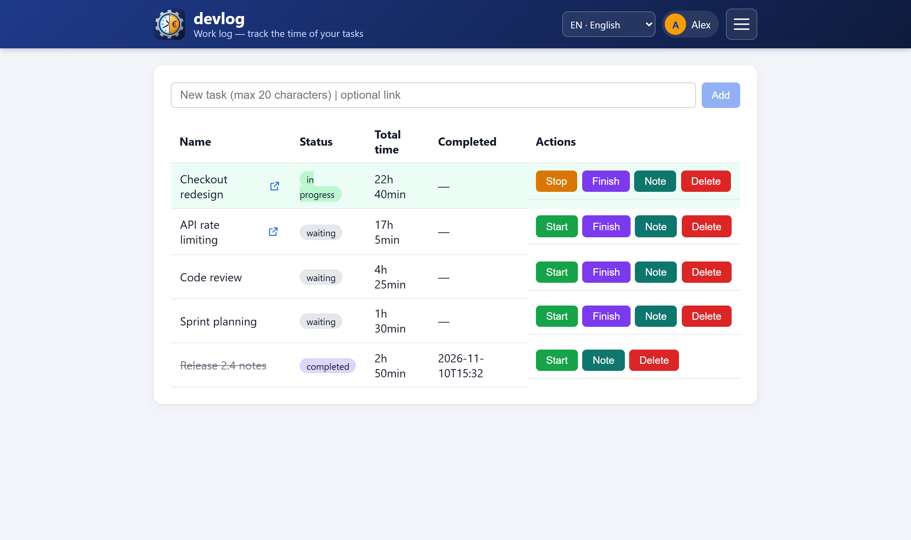

---

## Contents

- [Features](#features)
- [Tech stack](#tech-stack)
- [Architecture](#architecture)
- [User guide (with screenshots)](#user-guide)
- [CSV reports](#csv-reports)
- [Data model](#data-model)
- [REST API](#rest-api)
- [Running the application](#running-the-application)
- [Testing](#testing)

---

## Features

- **Tasks with timers** — add, rename, start, stop, finish and delete tasks. Total working time
  is shown per task and refreshed every minute.
- **One running task at a time** — starting a task automatically stops the one currently running.
- **Work sessions** — every start/stop is stored as a session (day, start, end). A scheduled job
  updates the running session every minute, and sessions crossing midnight are split per day.
- **Optional task link** — attach a URL to a task (e.g. an issue tracker ticket) and open it with one click.
- **Notes** — short notes (up to 200 characters) attached to a task, with timestamps, editing and deletion.
- **Monthly CSV reports** — *by task* and *by day*, including notes; Excel-friendly (UTF-8 BOM, `;` separator).
- **10 languages** — Polish, English, German, French, Spanish, Italian, Portuguese, Dutch, Czech,
  Ukrainian. Switching is instant (no reload) and also applies to CSV report headers.
- **No-login users** — each browser automatically becomes a separate user (secure HttpOnly cookie);
  users can set a display name and upload an avatar.
- **Single deployable** — one Spring Boot `jar` (or one Docker container) serves both the API and the frontend on port 8080.
- **Responsive** — works on desktop and mobile.

---

## Tech stack

| Layer | Technology |
|-------|------------|
| **Frontend** | Angular 21 (standalone components, signals, new control flow `@if`/`@for`), TypeScript 5.9, RxJS, lazy-loaded routes |
| **Frontend build** | Angular CLI with esbuild + Vite — minified, content-hashed bundles |
| **Frontend tests** | Vitest + jsdom |
| **i18n** | Custom lightweight `I18n` service (signals + `t` pipe), lazily loaded dictionaries, translated browser tab titles; type-checked so every language has every key |
| **Backend** | Spring Boot 4, Java 21, Spring Web MVC (REST), Spring Data JPA / Hibernate, Bean Validation, `@Scheduled` jobs, `MessageSource` for report labels |
| **Database** | H2 (file-based in production, in-memory for tests) |
| **Backend tests** | JUnit 5, Spring Boot test slices |
| **Build** | Maven (wrapper included) + `frontend-maven-plugin` — Maven downloads Node/npm and builds the Angular app into the jar |
| **Delivery** | Multi-stage Docker image (Maven + Node → JRE 21), Docker Compose with a persistent volume |
| **Web serving** | Spring Boot serves the SPA: hashed assets cached for 1 year (`immutable`), `index.html` with `no-cache`, gzip compression (e.g. `main-*.js` 95 kB → 27 kB) |

---

## Architecture

### Runtime overview

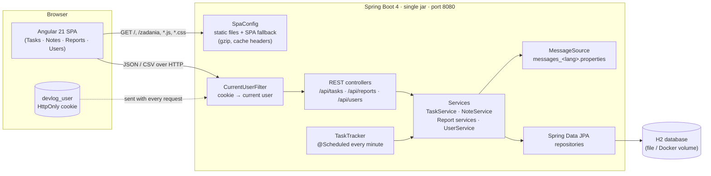

### Build pipeline

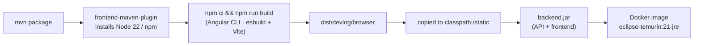

### Key design decisions

- **One artifact, one port.** The frontend is built by Maven and embedded in the Spring Boot jar,
  so there is no separate web server (no nginx) and no CORS configuration in production.
- **Anonymous per-browser users.** On the first request the backend creates a user and sets a
  random-token cookie (HttpOnly, 10-year lifetime). All tasks, sessions, notes and reports are
  scoped to that user — users never see each other's data.
- **Server-side time tracking.** Time is computed on the server from stored sessions, not in the
  browser. A scheduled job (`TaskTracker`) writes the current time into the running session every
  minute and recalculates task totals, so totals stay correct even if the browser is closed.
  The schedule is configurable (`devlog.tracker.cron`, `-` disables it).
- **Safe uploads.** Avatars are cropped to 128×128 PNG in the browser; the backend accepts up to
  256 kB and validates the image type by file content (e.g. SVG is rejected).
- **Feature-based packages.** Both frontend and backend are organised by feature
  (`tasks`, `notes`, `reports`, `users`, `i18n` / `task`, `note`, `report`, `user`, `web`).

### Project layout

```
.
├── src/app/              # Angular 21 frontend
│   ├── tasks/            # task list, timers, inline notes
│   ├── notes/            # notes page
│   ├── reports/          # CSV report download
│   ├── users/            # profile, avatar, user list
│   └── i18n/             # I18n service, `t` pipe, 10 dictionaries
├── backend/              # Spring Boot 4 (Maven) — builds and serves the frontend
│   └── src/main/java/com/devlog/
│       ├── task/         # tasks, work sessions, scheduled tracker
│       ├── note/         # notes
│       ├── report/       # CSV reports
│       ├── user/         # users, cookie filter, avatars, languages
│       └── web/          # SPA serving configuration
├── Dockerfile            # multi-stage build: Maven (+Node) → JRE 21
└── docker-compose.yml
```

---

## User guide

### 1. Tasks — the main screen

Open the app at `http://localhost:8080`. The task list shows each task's status
(**waiting**, **in progress**, **completed**), its total working time and the completion date.


- **Add a task:** type a name (max 20 characters) and press **Add**.
  To attach a link, use `Name | https://address` — e.g. `Checkout redesign | example.com/issues/142`.
  `https://` is added automatically if missing; the ↗ icon next to the name opens the link.
- **Rename:** click the task name, edit, press **Enter** to save or **Esc** to cancel.
  Removing the `| url` part removes the link.
- **Start / Stop:** only one task runs at a time — starting another task stops the current one.
- **Finish:** marks the task as completed (strikethrough). A completed task can be started again;
  this clears its completion date.
- **Delete:** removes the task together with its sessions and notes.

### 2. Adding a note

Click **Note** in a task row. A form opens under the row; type up to 200 characters and press
**Save note** (or **Ctrl+Enter**). The timestamp is recorded automatically.

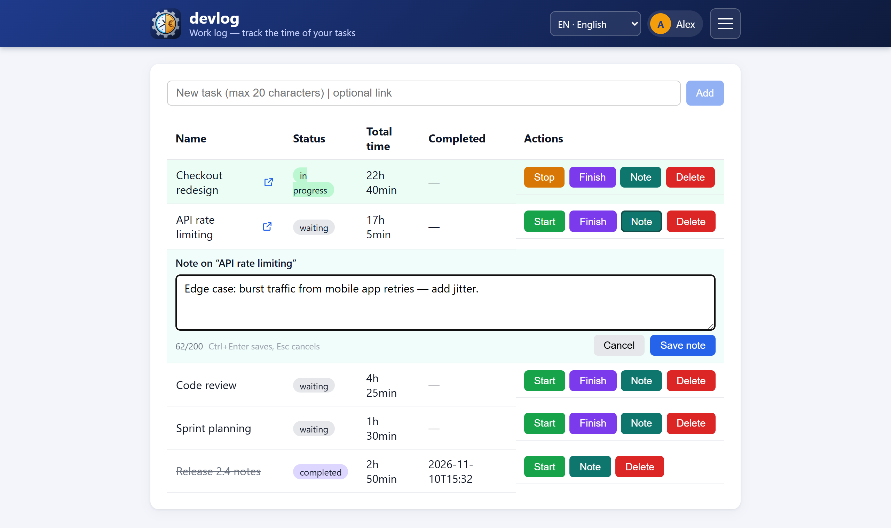

### 3. Navigation

Use the menu (☰) in the top-right corner to switch between **Tasks**, **Notes**, **Reports** and **Users**.

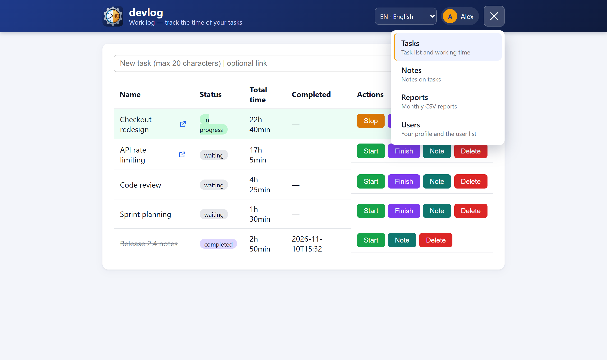

### 4. Notes

Choose a task, then pick a note from the list (newest first) to read it in full.
Notes can be **edited** (the original timestamp is kept and an "edited …" mark is shown) or **deleted**.
The selected task is kept in the URL (`/notatki?zadanie=<id>`), so the view can be bookmarked.

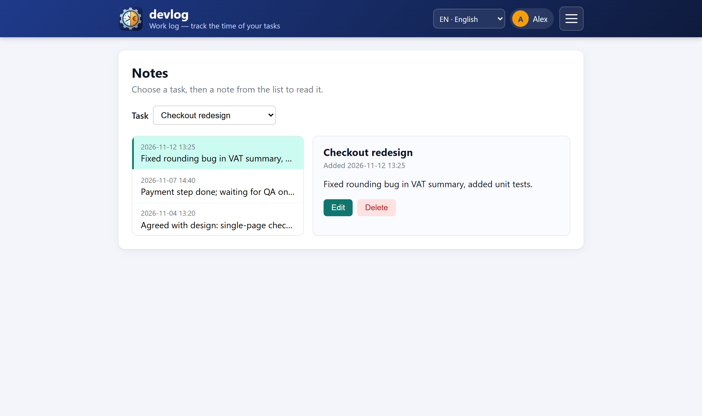

### 5. Reports

Choose a month (current + 5 previous) and download a report with one click — see [CSV reports](#csv-reports).

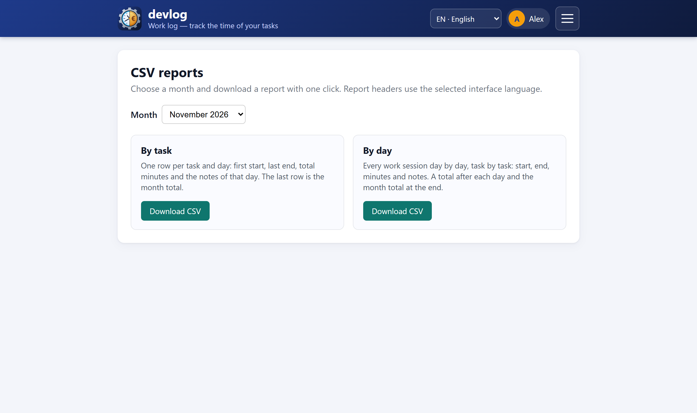

### 6. Users and profile

Each browser is its own user — no registration required. On the **Users** page you can:

- change your display name (max 30 characters),
- upload an avatar (PNG, JPG, WebP or GIF; cropped to a 128×128 square), change or remove it,
- see the list of users (your row is marked **You**).

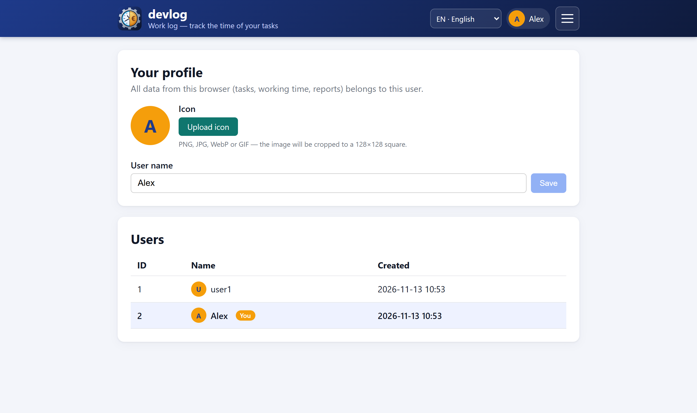

> Clearing browser cookies creates a new user; the previous data stays in the database but is no
> longer accessible from that browser.

### 7. Language

Pick a language from the selector in the header. The UI switches instantly, the choice is saved
with your user, and CSV report headers follow it. On the first visit the browser language is used
when supported.

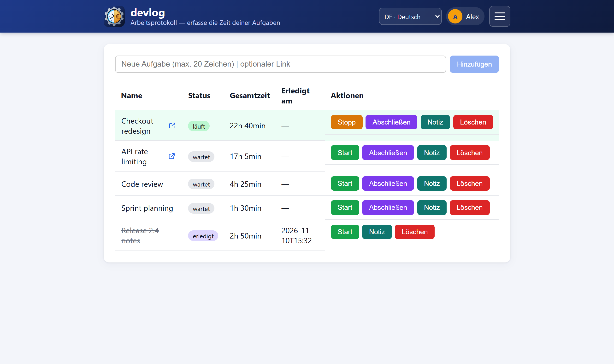

### 8. Mobile

The layout adapts to small screens; the task table scrolls horizontally.

<p align="center">
  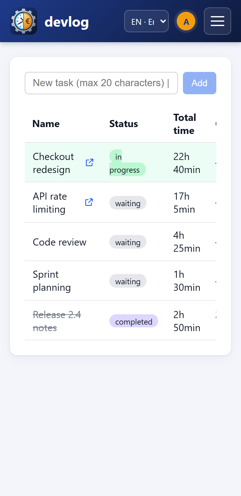
</p>

---

## CSV reports

Both reports are generated for the selected month, use the user's language for headers and totals,
and open correctly in Excel (UTF-8 with BOM, `;` separator).

**By task** — one row per task and day: first start, last end, minutes worked that day and that
day's notes. The last row is the month total.

```csv
Task;Day;Start;End;Day total [min];Notes
API rate limiting;2026-11-05;08:50;12:20;210;11:55 Token bucket per API key, 100 req/min default, configurable per plan.
Checkout redesign;2026-11-04;10:45;13:15;150;13:20 Agreed with design: single-page checkout, address autocomplete in phase 2.
Checkout redesign;2026-11-12;10:00;13:30;210;13:25 Fixed rounding bug in VAT summary, added unit tests.
```

**By day** — every work session, day by day and task by task, with a "Day total" row after each
day and the month total at the end. Each note is attached to the session of that task and day that
started most recently before the note.

```csv
Day;Task;Start;End;Time [min];Notes
2026-11-03;API rate limiting;12:30;15:10;160;
2026-11-03;Checkout redesign;09:05;11:40;155;
2026-11-03;Code review;15:20;16:05;45;
2026-11-03;Day total;;;360;
```

Full samples: [by task](docs/samples/sample-task-log.csv) · [by day](docs/samples/sample-day-log.csv)

---

## Data model

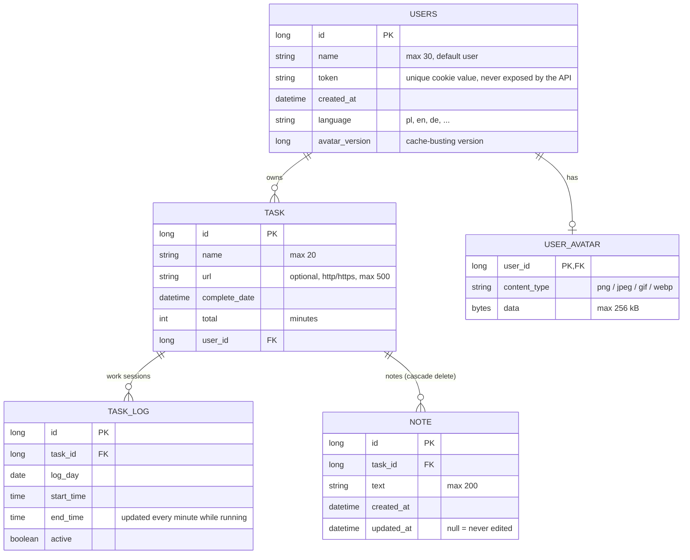

---

## REST API

All `/api/tasks` and `/api/reports` endpoints operate on the data of the user identified by the
`devlog_user` cookie.

| Method | Path | Description |
|--------|------|-------------|
| GET    | `/api/tasks` | List tasks (with sessions) |
| POST   | `/api/tasks` | Create task `{ "name": "...", "url": "..." }` (url optional) |
| PUT    | `/api/tasks/{id}` | Rename / change link `{ "name": "...", "url": "..." }` |
| DELETE | `/api/tasks/{id}` | Delete task |
| POST   | `/api/tasks/{id}/start` | Start (stops the currently running task) |
| POST   | `/api/tasks/{id}/stop` | Stop |
| POST   | `/api/tasks/{id}/complete` | Mark as completed |
| GET    | `/api/tasks/{id}/notes` | List notes (newest first) |
| POST   | `/api/tasks/{id}/notes` | Add note `{ "text": "..." }` |
| PUT    | `/api/tasks/{id}/notes/{noteId}` | Edit note |
| DELETE | `/api/tasks/{id}/notes/{noteId}` | Delete note |
| GET    | `/api/reports/task-log?month=yyyy-MM` | CSV report by task |
| GET    | `/api/reports/day-log?month=yyyy-MM` | CSV report by day |
| GET    | `/api/users` | List users |
| GET    | `/api/users/me` | Current user |
| PUT    | `/api/users/me` | Change name `{ "name": "..." }` |
| PUT    | `/api/users/me/language` | Set language `{ "language": "en" }` |
| PUT    | `/api/users/me/avatar` | Upload avatar (multipart, field `file`) |
| DELETE | `/api/users/me/avatar` | Remove avatar |
| GET    | `/api/users/{id}/avatar` | Avatar image (versioned with `?v=`) |

---

## Running the application

> The commands below apply to the (private) source repository.

### Docker (recommended)

Requires only [Docker Desktop](https://www.docker.com/products/docker-desktop/).

```bash
docker compose up --build
```

Open **http://localhost:8080**. Data is stored in the `devlog-data` volume
(`docker compose down -v` removes it).

### Single jar (no Docker)

Requires only JDK 21+ — Maven and Node.js are downloaded automatically by the Maven wrapper.

```bash
cd backend
./mvnw package -DskipTests        # Windows: mvnw.cmd package -DskipTests
java -jar target/backend-0.0.1-SNAPSHOT.jar
```

### Development mode (frontend hot reload)

```bash
# terminal 1 — backend on :8080, without building the frontend
cd backend && ./mvnw spring-boot:run -DskipFrontend

# terminal 2 — Angular dev server on :4200 with /api proxied to :8080
npm install && npm start
```

---

## Testing

```bash
npm test                                # frontend unit tests (Vitest)
cd backend && ./mvnw test -DskipFrontend   # backend tests (JUnit 5, in-memory H2)
```
